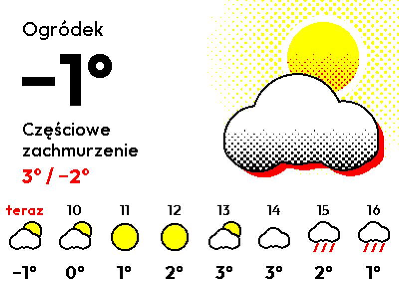
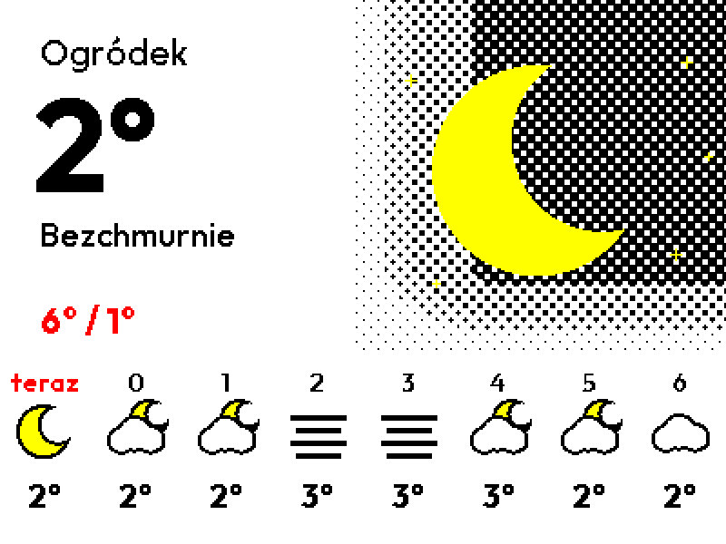
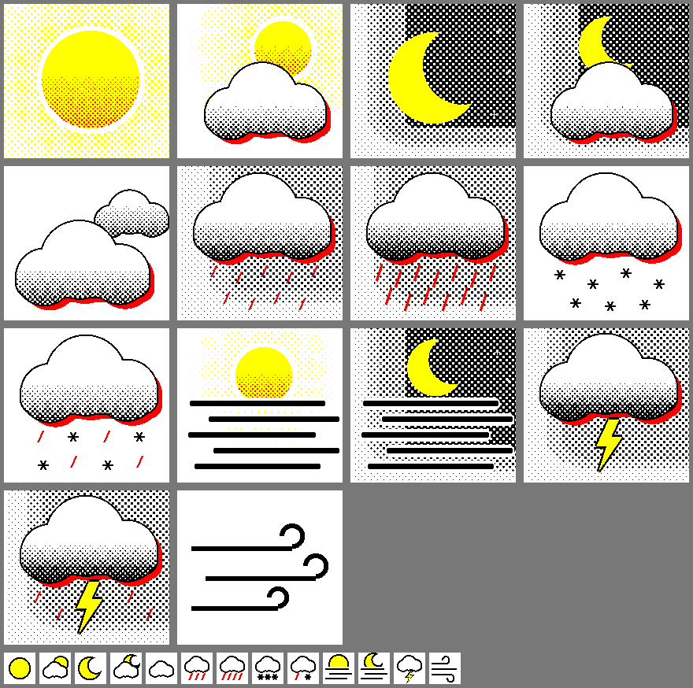

# Home Assistant weather display for the Zectrix Note 4C

ESPHome firmware that turns the [Zectrix Note 4C](https://wiki.zectrix.com/en/hardware/note4c/quick-start) into a battery-powered weather display. It shows an outdoor temperature and an hourly forecast from Home Assistant, on a 4.2" black, white, red and yellow e-paper panel.

| Day | Night |
|---|---|
|  |  |

These are generated previews with sample data. On the real panel, the inks are more muted and the text may differ slightly.

**Status:** a working personal project, shared as is. Battery life hasn't been measured yet. See [Known limitations](#known-limitations).

## How it works

1. In Home Assistant, an automation runs every 10 minutes and writes a compact summary of the temperature and forecast to a text helper.
2. The device wakes every 15 minutes, connects to Home Assistant and reads the helper.
3. If the value changed, the device redraws, which takes about 20 seconds. Then it goes back to sleep.

The screen shows a small warning in three cases: Home Assistant has been unreachable for 8 wakes in a row (about 2 hours), the data is over an hour old, or the battery is low. Warnings cause one redraw when they appear and one when they clear.

The device only reads the helper, so it doesn't need permission to perform actions in Home Assistant. All the forecast logic stays in Home Assistant, where it's easy to change without rebuilding firmware.

## What you need

- A Zectrix Note 4C. This firmware won't work on the black-and-white Note 4, which has a different panel.
- Home Assistant with the ESPHome and sun integrations, and a weather entity that provides hourly forecasts.
- [ESPHome](https://esphome.io/) 2026.10 or newer, either the CLI or the Device Builder add-on.
- A 2.4 GHz Wi-Fi network.

## Setup

### 1. Back up the factory firmware

Flashing replaces the factory firmware, so save the whole flash first. Keep the file private: it can contain data from your device. If the port isn't detected, enter download mode: hold the round BOOT button, press the RESET pinhole once, then release BOOT.

```bash
pip install esptool
```

```bash
python -m esptool --chip esp32s3 --port COM3 --baud 460800 read-flash 0x0 0x1000000 note4c-factory.bin
```

Replace `COM3` with your device's port. To restore it later, use `write-flash 0x0 note4c-factory.bin` in place of the `read-flash` arguments.

### 2. Set up Home Assistant

Copy [homeassistant/note4c_screen.yaml](homeassistant/note4c_screen.yaml) into your [packages](https://www.home-assistant.io/docs/configuration/packages/) folder and set your two entities under `variables`. Restart Home Assistant, then check that `input_text.note4c_screen` fills with data.

You can also create the helper and automation in the UI, using the same values.

### 3. Configure the firmware

Copy [esphome/secrets.example.yaml](esphome/secrets.example.yaml) to `esphome/secrets.yaml` and fill it in. You won't know the device's IP address before the first flash, so a placeholder is fine for `note4c_address` at first. Once you know it, update the secret and flash again.

To use Device Builder, the art needs to go with the config. Create a bundle with `esphome bundle esphome/note4c.yaml` and import it in Device Builder. The bundle includes your secrets, so don't share it.

The settings at the top of [esphome/note4c.yaml](esphome/note4c.yaml) cover the wake interval, the label above the temperature, and the helper's name. Screen text is in Polish. To change the language, edit `text_for` and the `"teraz"` label in the same file, and add any new letters to the fonts' `glyphs`.

### 4. Flash over USB

```bash
esphome run esphome/note4c.yaml --device COM3
```

### 5. Add it to Home Assistant

Press BOOT, which keeps the device awake for 3 minutes, then add the ESPHome integration using the device's IP address and the API key from your secrets.

## Buttons

| Button | What it does |
|---|---|
| **BOOT** (round, front) | Wakes the device, reads fresh data, and keeps it awake for 3 minutes |
| **RESET** (pinhole) | Restarts the device, also with the 3-minute window |
| **UP, DOWN** | Not used by this firmware. On the board, DOWN is also the power key |

## Updating over Wi-Fi

The upload has to arrive during the 3 minutes after you press BOOT, and a build can take longer than that, so build first:

1. Build the firmware: `esphome compile esphome/note4c.yaml`, or a build in Device Builder.
2. Press **BOOT**.
3. Upload it: `esphome upload esphome/note4c.yaml --device <ip>`, or Install in Device Builder.

Waking the device first matters. With mDNS on, Device Builder keeps showing the sleeping device as online, so Install tries to send straight away and usually fails.

New firmware is only confirmed once it has read valid screen data from Home Assistant. Until then, the bootloader returns to the previous firmware on the next start, so an update that crashes or uses the wrong helper name is undone.

## Known limitations

- **Battery life isn't measured yet.** The firmware reports battery level to Home Assistant, using the vendor's voltage curve, which hasn't been checked against this battery. It redraws whenever anything visible changes, such as a temperature crossing a rounding boundary, so this can be far more often than hourly, up to once per wake.
- **Possible crash on sleep:** an early test build crashed once in `mdns_free` when entering deep sleep. mDNS is needed for Device Builder to find the device. The crash hasn't been seen in testing since, but that testing was brief, and it hasn't been run for long at the final 15-minute interval.
- **Slow refresh:** the panel only does full refreshes of about 20 seconds, with visible flashing. That's normal for four-colour e-paper.

## Changing the art

The art is drawn by Python scripts in [design/](design), using halftone dots to get extra tones from four inks. Install what they need with `pip install -r design/requirements.txt`, then run them:

```bash
python design/art.py
```

```bash
python design/preview.py
```

`art.py` writes the images that get built into the firmware to `esphome/art/`. To send them to Device Builder, create and import a bundle as in step 3.



## Credits and licence

MIT licensed. See [LICENSE](LICENSE). The panel's init sequence and pin mapping come from the MIT-licensed [reference firmware](https://github.com/LazyYoun/youn-ink-fourcolor-firmware): see [THIRD_PARTY_NOTICES.md](THIRD_PARTY_NOTICES.md).

This is an independent project, not affiliated with or endorsed by Zectrix.
